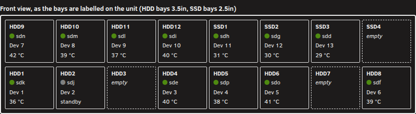
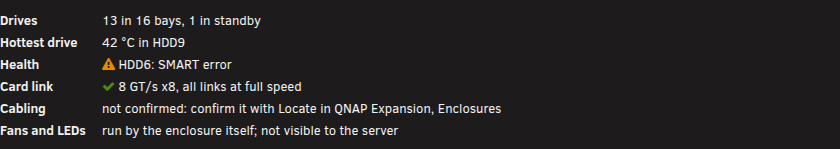
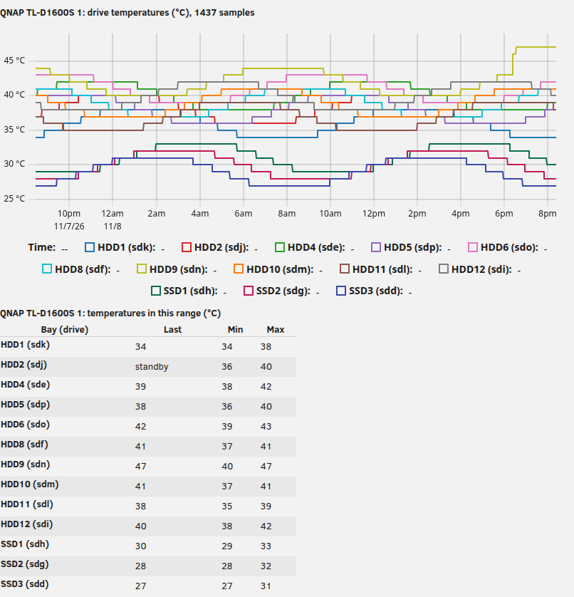
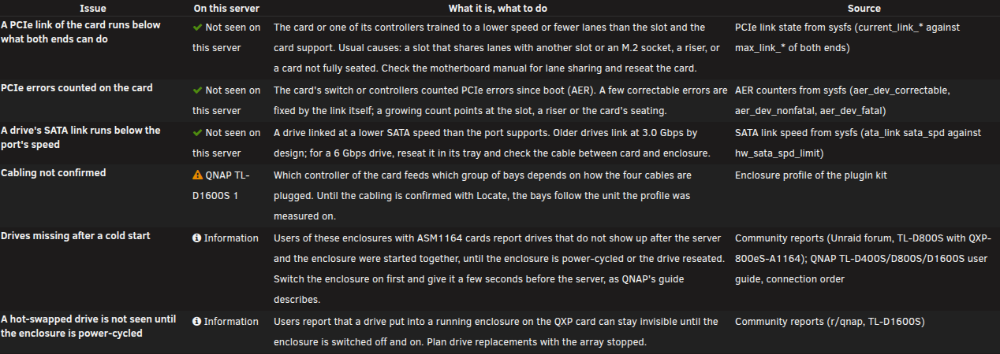

# QNAP Hardware: an Unraid plugin for the QNAP TL-D1600S JBOD enclosure

A live overview of the enclosure: front view and bay map, bay labels on the Main page, drive temperature history, a hardware inventory with known issues and firmware, and an anonymised hardware report.

## Companion plugin

**[QNAP Expansion](https://github.com/luuvasara/unraid-qnap-expansion)** checks the enclosure's QXP card (driver, PCIe links, error counters, SATA links), finds a drive with Locate and confirms the cabling, so that every drive is shown in its bay.
This plugin works on its own; both read the same enclosure profile and share the confirmed cabling.

## What it does

| | |
|---|---|
| Overview | a live front view of the enclosure as its bays are labelled (HDD1-HDD12, SSD1-SSD4), each drive with its Unraid slot, temperature and state as Unraid last read them, redrawn every 10 seconds; one card per unit; the bay map. No drive is woken |
| Main page | the bay ("HDD3") after each drive's name (setting on the Overview tab) |
| History | drive temperatures per bay over 1, 6 or 24 hours, one sample a minute kept in RAM, with the same numbers as a table (setting on the Overview tab: off, and nothing runs in the background) |
| Hardware | the card's PCIe links and error counters, the controllers' capabilities, each drive's SATA link, firmware and SMART counters; known issues checked against your server; what firmware can and cannot be read |
| Report | a read-only hardware report, anonymised on the server (serials, MACs, WWNs, UUIDs, labels, hostname, IPs, user names become placeholders), to copy, download or open as an issue here |

### Fans and LEDs

The enclosure runs its fans itself, from the fan switch at the back (Auto follows its own temperature), and drives its status and drive lights itself. The server has no way to reach them: the card shows no SES device and no USB link, and its controllers offer no enclosure management. So this plugin does not control them, and the Hardware tab says so. To find a drive, use Locate in QNAP Expansion.

## Supported hardware

The TL-D1600S on the QXP-1600eS-A1164 card. Other QNAP enclosures and cards are not mapped yet; the Report tab collects what they look like.

## Screenshots

Taken in the offline test harness with made-up test data.

Overview: the front view.

Overview: the unit at a glance.

History: drive temperatures per bay.

Hardware: known issues checked against the server.

## Install

Unraid webGui: **Plugins, Install Plugin**, paste

    https://raw.githubusercontent.com/luuvasara/unraid-qnap-hardware/main/qnap-hardware.plg

The package is downloaded from `packages/` in this repository and checked against the MD5 in the `.plg`. Settings are kept on the flash drive in `/boot/config/plugins/qnap-hardware/`.

## Repository layout

| path | what |
|---|---|
| `qnap-hardware.plg` | the plugin manifest (version, package URL and MD5, install and remove, changes) |
| `src/` | the package tree: the pages, the history sampler, the report collector and anonymiser, the known-issues data, uPlot 1.6.32 (MIT) for the graphs |
| `kit/` | the shared plugin kit: About tab, install notes, build, and the enclosure layer (the TL-D1600S profile, the front view, the Main page labels) |
| `tests/` | `run-tests.sh`: logic, the report collector and anonymiser, the cron setting, and the render test in headless Chrome; `serve.sh` serves the pages locally |
| `packages/` | the built package of the version in the `.plg` |

Build on a workstation: `./build.sh` (bump the version in the `.plg` first), then `tests/run-tests.sh`.

## Licence

GPL-2.0, see [LICENSE](LICENSE). uPlot is MIT, see `src/usr/local/emhttp/plugins/qnap-hardware/vendor/uplot-1.6.32/LICENSE`.
